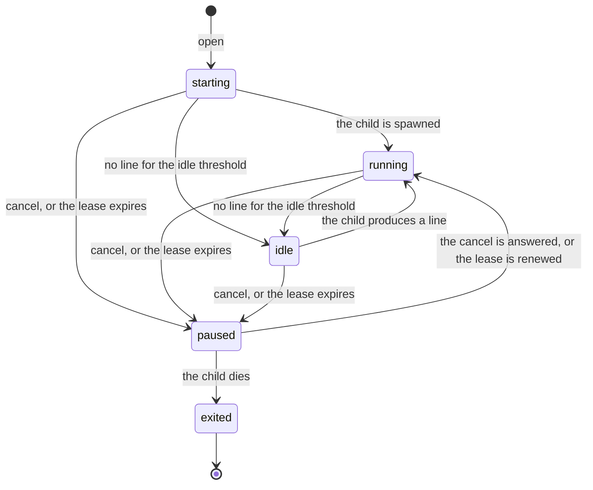

# botd session states

The lifecycle of one bot session as `botd` reports it: the states a session
can be in, the transitions between them, the frames the client sees and what
a state means for the client.

The wire format is described in [PROTOCOL.md](PROTOCOL.md); this document
describes the state machine only. Every statement below is derived from the
sources:

* `botd/src/protocol.ts` — the `SESSION_STATES` union and the `state` frame.
* `botd/src/session.ts` — the state machine of a session (`setState`,
  `requestCancel`, `terminate`, the exit handler).
* `botd/src/daemon.ts` — the watchdog, the lease pause, the `open`, `send`,
  `cancel` and `resume` handling and the frames.

What the code does not decide is listed in
[What is not verified](#what-is-not-verified) and marked *unverified*.

## The states

`SESSION_STATES` in `botd/src/protocol.ts` is the union of the states; there
are five of them and every one of them is part of the wire protocol.

| state | meaning | set by |
| --- | --- | --- |
| `starting` | the session is open and the child is spawned, but the child has not produced a line yet | `Session` (the initial value), `Botd.onOpen`, `Botd.computeState` |
| `running` | the child produced a line less than `--idle-ms` ago (2 s by default) | `Session.start`, `Session.onCancelAnswered`, `Botd.computeState` |
| `idle` | the child is silent for `--idle-ms` (2 s by default) | `Botd.computeState` (the watchdog) |
| `paused` | the session takes no input: a cancel is pending or the lease expired | `Session.requestCancel`, `Botd.updateLease`, `Botd.tick` |
| `exited` | the child is gone | `Session.onExit`, `Botd` (the records it loads at start) |

Two details of the union:

* `starting` is not only the first state: `Botd.computeState` reports it
  again for a child that produced no line since the session was opened.
* `paused` covers two different reasons (a pending cancel and an expired
  lease). The `state` frame carries no reason; the reasons are told apart by
  the error codes of the refused `send` frames (see
  [The rules](#the-rules)).

## The transitions

The watchdog runs every `--watchdog-ms` (250 ms by default) and is the only
place where the silent states (`idle`) and the lease pause are detected; the
changes a session makes itself (the spawn, the cancel and the exit) happen
in the moment.

| from | trigger | to | frame |
| --- | --- | --- | --- |
| — | `open` | `starting` | `state` |
| `starting` | the child is spawned | `running` | `state` |
| `starting` | no line for `--idle-ms` | `idle` | `state` |
| `running` | no line for `--idle-ms` | `idle` | `state` |
| `idle` | the child produces a line | `running` | `state` |
| `starting`, `running`, `idle` | `cancel` | `paused` | `state` |
| `paused` | the child answers the cancel (it produces a line) | `running` | `state` |
| `paused` | the escalation kills the child | `exited` | `state` |
| `starting`, `running`, `idle` | the lease passes its TTL | `paused` | `state` (one per session) |
| `paused` | `renew` or `hello` | `starting`, `running`, `idle` | `state` |
| `paused` | the lease passes twice its TTL | `exited` | `state` |
| `running`, `idle`, `paused` | `close` | `exited` | `state` |
| `exited` | — | — | none |

Notes on the table:

* `open` is answered with a `state` frame (`starting`) and the spawn of the
  child changes the state to `running` right away: the client usually sees
  `starting` and `running` back to back.
* A state change that does not change the state emits no frame
  (`Session.setState` calls the hook only on a real change); the only frame
  that repeats a state is the answer to a `resume`, which reports the
  current state of the session.
* The transition `idle` → `running` is reported by the next watchdog tick,
  not by the line itself: the line is an `event` frame, the state follows
  within `--watchdog-ms`.
* The escalation of a cancel (SIGINT after `--cancel-grace-ms`, SIGKILL
  after `--cancel-kill-grace-ms`) does not change the state on its own; only
  the death of the child does, and that is the `exited` row.
* `close` removes the session from the table at once; the `exited` frame
  follows when the child is gone.

## The diagram



The same machine in ASCII:

```ascii
   open ──▶ starting ──(the child is spawned)──▶ running
               │                                  ▲
               │ (no line for --idle-ms)          │  a line again
               ▼                                  │
             idle ────────────────────────────────┘

   starting / running / idle
                 │
                 │ cancel, or the lease passes its TTL
                 ▼
               paused --(the child answers the cancel)──▶ running
                 │
                 │ the child dies: escalation, dead lease, close
                 ▼
               exited
```

## The rules

### The cancelling flag

`cancelling` is **not** a state: it is a flag of the session
(`Session.cancelling`), the daemon reports it in `SessionStatus` and the
`state` frame never carries it. While the flag is set the state of the
session is `paused`.

The rules of the flag (`Session.requestCancel`, `Botd.onCancel`):

* `cancel` writes the payload (or the default cancel message of the bot
  kind) to the stdin of the child, sets the flag and changes the state to
  `paused`. The client sees a `state` frame with `paused`.
* While the flag is set, `send` is refused with the error code
  `session_cancelling`. The refusal comes after the checks of the lease and
  of the child, so a paused lease is reported as `lease_paused` first.
* The escalation waits `--cancel-grace-ms` (3 s) and then signals the
  process group with SIGINT; `--cancel-kill-grace-ms` (3 s) later the group
  gets the SIGKILL. The state stays `paused` during the escalation.
* A child that answers the cancel (it produces a line) clears the flag and
  stops the escalation; the state goes back to `running` and the session
  takes input again.
* A second `cancel` replaces the escalation of the first one; the flag stays
  set.
* A child that dies clears the flag; the state becomes `exited`.
* The watchdog skips a session with a pending cancel, so such a session
  never becomes `idle` and raises no `stall` frame.

### Paused by the lease

The lease has its own states (`none`, `ok`, `paused`, `dead` in
`botd/src/lease.ts`); they are not session states and they are not on the
wire.

* The lease is `ok` until `renewedAt + ttl`. It is `paused` until
  `renewedAt + 2 * ttl` and `dead` after that.
* When the lease becomes `paused`, every live session is changed to
  `paused` and the children stay alive; the daemon logs `lease expired, the
  sessions are paused`.
* While the lease is `paused` (and while it is `dead`), `send` is refused
  with the error code `lease_paused`.
* A `renew` before the first deadline or a `hello` brings the lease back to
  `ok` and wakes the sessions up: every live session that is not cancelling
  gets the state that `Botd.computeState` reports (`starting`, `running` or
  `idle`).
* When the lease becomes `dead`, the children are terminated (SIGTERM, then
  SIGKILL after `--terminate-grace-ms`, 3 s); the sessions end up in
  `exited`.
* A `renew` that arrives after the first deadline is refused with
  `lease_expired`; the client has to send `hello` again.

### The exited session

* `exited` means that the child is gone: it was closed, it died, the
  escalation killed it or the lease died.
* `send` and `cancel` of an exited session are refused with the error code
  `session_exited`.
* `resume` of an exited session answers with a `gap` frame for the events
  that are gone (if the session had any) and a `state` frame with `exited`;
  a `sid` that the daemon does not know at all is refused with
  `unknown_session`.
* The state of a session that outlived the daemon is kept in the session
  table as `exited`; the client can read the `providerSessionId` of the
  table and continue the conversation in a new session with `open` and
  `resume.providerSessionId`.
* The `exited` state is final: a session that is gone is not revived. A new
  `open` with the same `sid` starts a new session.

## What a state means for the client

| state | may `send`? | may `resume`? | what the client does |
| --- | --- | --- | --- |
| `starting` | yes | yes | wait for the first `event` |
| `running` | yes | yes | the normal case |
| `idle` | yes | yes | the child is silent; a `stall` frame follows after `--stall-ms` |
| `paused` | no | yes | `send` is refused: `session_cancelling` (cancel pending) or `lease_paused` (lease expired) |
| `exited` | no | yes, but the events are gone | `open` a new session, with `resume.providerSessionId` from the table |

More on the two columns:

* `resume` replays the events of the ring buffer from `fromSeq` and answers
  with a `state` frame; it works in every state, also while a cancel is
  pending. The events of an exited session are lost, so the answer carries a
  `gap` frame.
* `send` is refused in `paused` and in `exited`; the error code tells the
  client why (`session_cancelling`, `lease_paused`, `session_exited`).
* The state frame of a `paused` session does not say whether the pause comes
  from a cancel or from the lease; the client has to wait for the error
  code of a refused `send` or for the next state frame.

## Internal states

None. Every state of the transition table is listed in
[PROTOCOL.md section 5](PROTOCOL.md#5-the-state-machine) and is part of the
wire protocol. A state that is internal would be listed here as a bullet
with its name and marked with *internal*.

## What is not verified

The following points are not decided by the code and are marked *unverified*:

* *unverified* — the order of the `state` frames when the lease pauses
  several sessions at once: the daemon iterates over its sessions, but the
  protocol does not promise an order.
* *unverified* — whether a client always sees the `exited` frame of a
  session that was closed with `close`: the session leaves the table before
  the child dies, so the frame is emitted, but nothing guarantees that it
  reaches the client.
* *unverified* — whether a future version of the protocol adds the reason of
  a pause to the `state` frame; today the frame carries `sid`, `state` and
  `progressAt` only.
